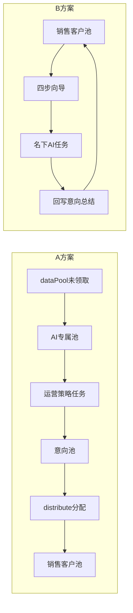

# 方案对比 · A 独立板块 vs B 深度嵌合

## 一句话

| | 方案A 独立板块承接式 | 方案B 深度绑定嵌合式 |
|--|---------------------|---------------------|
| 谁用 | 运营为主 | 销售为主 |
| 线索从哪来 | `dataPool` **未领取**公共线索 | 客户池 **名下**线索 |
| CRM 怎么长 | 侧栏**新增**「AI外呼中心」 | **改造**客户池 + 新增任务/记录/配置/看板 |
| 价值 | 统一吞吐公共池，提升整体触达 | 销售自助清私海未接通库存 |
| 基线文档 | 本设计包方案A说明 | `PRD-AI外呼机器人-CRM融合版.md` |

## 适用场景

- **选 A：**公共池积压严重、领取积极性不足、需要运营统一控频控时段控通道，并集中做企微承接再分配。  
- **选 B：**销售名下已有大量未接通/低意向，需要本人一键圈选发起 AI，结果直接回写自己的客户池。  
- **并列：**A 清公共池，B 清私海；共享话术、红线词、通道并发、意向字典；线索 AI 状态互斥。

## CRM 触点对照

| 触点 | A | B |
|------|---|---|
| `customer/ongoing` | 分配后落点（不改操作区） | **入口+向导** |
| `dataPool` | **水源** | 不直接用 |
| `distribute` | 意向池分配 | 一般不走（已在名下） |
| `weworkBot/globalConfig` | 布局参考；承接账号**独立页** | 加微可复用能力 |
| `callRecord` | 写入 | 写入 |
| 未拨打领取额度 | AI池锁定不领；承接豁免 | 基本不变；承接加微可豁免 |
| 来源「AI机器人」 | 分配入库时覆盖 | 筛选可用；转入时按私域 PRD |
| 火山/阿里看板 | 运营总览 | 个人+对比 |

## 流程差异

## 落地建议

1. **先 B 灰度**（融合 PRD 已较完整）：单组销售验证回写与投诉率。  
2. **再 A 小流量**：验证抽取锁、额度豁免、承接账号。  
3. **后并联全量**：统一对账 waihudata；质检抽检两边录音。  
4. 产品叙事：不要做成两套 CRM，而是同一套 WH_CRM_v2 上的两种 AI 产能入口。

## 明确非目标（两边共同）

- 通话中转人工  
- 自建线路采购  
- 替换人工一键外呼  
- 话术全自动生成  

## 文档与原型

- 原型A：`/workspace/ai-crm-outbound-design/scheme-a/index.html`  
- 原型B：`/workspace/ai-crm-outbound-design/scheme-b/index.html`  
- Hub：`/workspace/ai-crm-outbound-design/index.html`  
