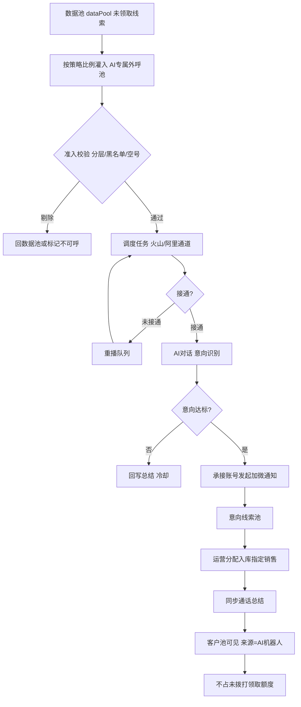
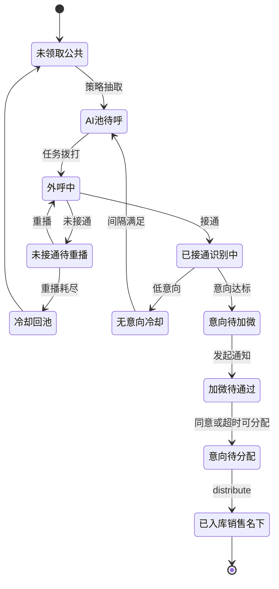

# 方案A · 独立板块承接式 · 系统说明

> 产品：武汉电销系统 / 重洋启思电销系统（`/WH_CRM_v2/`）  
> 原型：`scheme-a/index.html`  
> 角色重心：**运营**统一吞吐销售未领取的公共线索

## 1. 问题与目标

数据池（`dataPool`）中大量未领取线索靠销售主动领取效率不足；人工外呼成本高、未接通占比大。方案A在 CRM 侧栏新增一级「AI外呼中心」，由运营配置策略后，AI 全量/按比例外呼未领取线索，筛出意向后走企微承接加微，再在线分配入库给指定销售，并同步外呼总结。

## 2. CRM 挂载（复用 vs 新增）

| 模块 | 现网路径 | 动作 | 说明 |
|------|----------|------|------|
| 数据池 | `dataPool` | 复用+抽取 | 未领取线索水源；抽取后锁定防双领 |
| 客户池 | `customer/ongoing` | 复用 | 分配入库后出现在销售名下 |
| 付费线索池 | `customer/payClue` | 复用 | 分层 A/B/C/D 口径 |
| 分配 | `distribute` | 复用+调用 | 意向池「在线分配入库」 |
| 企微全局配置 | `weworkBot/globalConfig` | 复用布局 | 承接账号页视觉对齐，数据独立 |
| 通话记录 | `callRecord` | 复用字段 | AI 通话写入，主体标记 |
| AI专属外呼池 | `aiOutbound/pool` | **新增** | 运营主工作台 |
| 外呼策略 | `aiOutbound/strategy` | **新增** | 频率/时段/比例/重播/通道 |
| 企微承接账号 | `aiOutbound/weworkAccount` | **新增独立页** | 加微通知账号 |
| 意向线索池 | `aiOutbound/intentPool` | **新增** | 导出/分配/总结 |
| 任务/看板/明细 | `aiOutbound/*` | **新增** | 对齐 waihudata |

**不改：**客户池一键外呼/锁定/收藏/转移；销售未拨打领取上限公式（AI 相关线索按豁免口径处理）。

## 3. 主流程

## 4. 线索状态机

## 5. 与领取额度 / 分配的关系

参照《PRD-企微承接额度》：

1. AI 池锁定期间，销售领取接口对该线索返回「AI处理中」，不可领。
2. 经 AI 加微活码进线并首次自动承接的销售，**不计入未拨打领取额度**。
3. 转交/回收后再分配给其他销售：恢复占用额度。
4. 来源覆盖为「AI机器人」（《CRM线索池私域筛选》PRD）。

## 6. 策略配置要点

- **频率：**单线索每日/7天/累计上限、最小间隔、日吞吐上限  
- **时段：**上午/下午/晚间；强制禁呼 22:00–08:00 不可覆盖  
- **比例量级：**从 dataPool 日抽取比例与来源权重  
- **重播：**未接通次数与间隔；原因枚举对齐数据中心  
- **通道：**火山 / 阿里（+可选软电话降级）；公司并发令牌  
- **准入：**默认仅 C/D；A/B 禁止；高净值/已加微/黑名单/空号强制剔除  

## 7. 企微承接账号独立页

- 配置多个承接企微账号、日承接上限、轮询/额度加权  
- 加微文案模板、失败换号重试  
- 布局借鉴 `weworkBot/globalConfig`，**配置数据与销售企微机器人全局配置分离**  

## 8. 指标口径

与 `https://pages.yc345.tv/waihudata/` 对齐：外呼通数、接通率、有效接通≥10s、意向等级、加微节点/同意加微、未接通原因、通话总结、导出明细；主体维度火山/阿里。

## 9. 验收要点

1. 抽取后销售端不可领同一条（无双领）。  
2. 策略变更下一调度窗口生效；禁呼不可破。  
3. 意向达标触发加微；同意后进意向池。  
4. 分配入库后客户池可见总结；来源=AI机器人；额度豁免正确。  
5. 看板可与 waihudata 对账（误差目标 &lt;2%）。  

## 10. 原型屏幕清单

AI专属外呼池 · 外呼策略配置 · 企微承接账号 · 意向线索池 · 外呼任务监控 · 外呼数据看板 · 通话明细 · 系统说明（含 mermaid）
