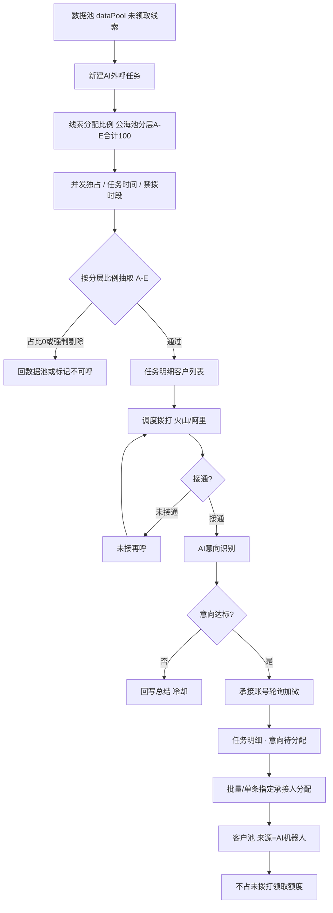
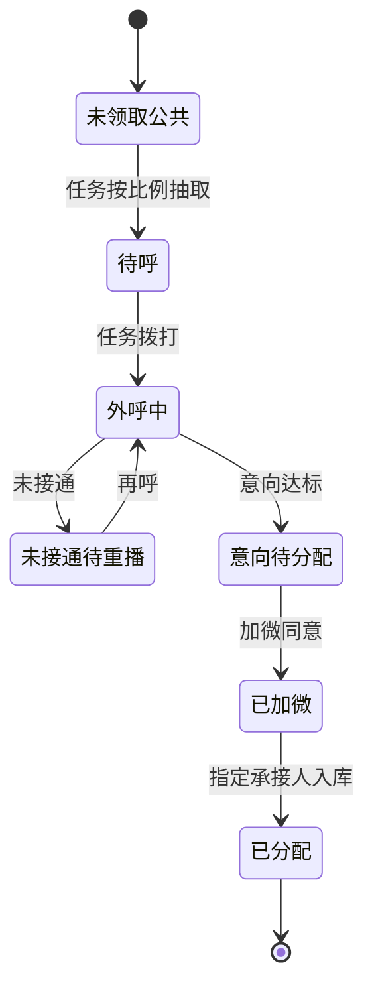

# 方案A · 独立板块承接式 · 系统说明

> 产品：武汉电销系统 / 重洋启思电销系统（`/WH_CRM_v2/`）  
> 原型：`scheme-a/index.html`  
> 角色重心：**运营**统一吞吐销售未领取的公共线索

## 1. 问题与目标

数据池（`dataPool`）中大量未领取线索靠销售主动领取效率不足；人工外呼成本高、未接通占比大。方案A在 CRM 侧栏新增一级「AI外呼中心」，以 **AI任务** 创建每日外呼任务（含公海池线索分层比例、并发、禁拨时段），在 **任务明细** 查看客户并批量指定承接人分配入库；企微承接账号按渠道活码成员样式配置。

## 2. CRM 挂载（复用 vs 新增）

| 模块 | 现网路径 | 动作 | 说明 |
|------|----------|------|------|
| 数据池 | `dataPool` | 复用+抽取 | 未领取线索水源；按任务比例抽取后锁定防双领 |
| 客户池 | `customer/ongoing` | 复用 | 分配入库后出现在销售名下 |
| 付费线索池 | `customer/payClue` | 复用 | 分层 A/B/C/D 口径 |
| 分配 | `distribute` | 复用+调用 | 任务明细「批量/单条指定承接人」 |
| 渠道活码成员 | 组织架构弹窗 | 复用交互 | 承接账号添加成员 |
| 企微全局配置 | `weworkBot/globalConfig` | 复用布局参考 | 承接账号页数据独立 |
| 通话记录 | `callRecord` | 复用字段 | AI 通话写入，主体标记 |
| AI任务 | `aiOutbound/tasks` | **新增** | 创建/管理每日任务；合并原策略+池入口 |
| 任务明细 | `aiOutbound/taskDetail` | **新增** | 任务下客户列表；合并原意向池 |
| 企微承接账号 | `aiOutbound/weworkAccount` | **新增独立页** | 成员+加微通知（仅轮询） |
| 看板/明细/说明 | `aiOutbound/*` | **新增** | 对齐 waihudata |

**已合并下线（作为独立菜单）：** AI专属外呼池、外呼策略配置、意向线索池、外呼任务监控。

**不改：**客户池一键外呼/锁定/收藏/转移；销售未拨打领取上限公式（AI 相关线索按豁免口径处理）。

## 3. 主流程

## 4. 线索状态机

## 5. 与领取额度 / 分配的关系

1. 任务抽取锁定期间，销售领取接口对该线索返回「AI处理中」，不可领。
2. 经 AI 加微活码进线并首次自动承接的销售，**不计入未拨打领取额度**。
3. 转交/回收后再分配给其他销售：恢复占用额度。
4. 来源覆盖为「AI机器人」。

## 6. AI任务配置要点

- **线索分配比例：**对齐公海池分层 A/B/C/D/E %（默认 5/15/5/5/70），合计必须 = 100%；与准入合并，按分层占比从数据池抽取；计划外呼量与比例分离
- **并发：**可分配机器人并发/总并发；独占模式；任务并发 1–可分配上限
- **时间：**任务时间区间；禁拨时段可多条；政策 **21:00–次日 09:00** 不可外呼；未接再呼开关+次数/间隔
- **分层抽取：**A–E 占比即准入与分配；占比为 0 的分层不抽取；高净值/已加微/黑名单/空号仍强制剔除
- **通道：**火山 / 阿里

## 7. 企微承接账号独立页

- 成员列表对齐**渠道活码**展示（头像/姓名/userid/部门/今日承接/上限）
- **添加成员**打开组织架构筛选弹窗（左树右已选）
- 加微通知策略：初始化**仅轮询**；配置加微昵称、企业微信邀请通知模版、加微通过欢迎语、失败重试
- 布局借鉴 `weworkBot/globalConfig`，**配置数据与销售企微机器人全局配置分离**

## 8. 指标口径

与 `https://pages.yc345.tv/waihudata/` 对齐：外呼通数、接通率、有效接通≥10s、意向等级、加微节点/同意加微、未接通原因、通话总结、导出明细；主体维度火山/阿里。

## 9. 验收要点

1. 创建任务时公海池分层比例（A–E）合计 ≠100% 不可提交；禁呼时段不可破。  
2. 任务明细可切换任务；意向与池内客户同表；支持批量指定承接人。  
3. 企微承接可走组织架构添加成员；加微策略分配方式固定轮询。  
4. 分配入库后客户池可见总结；来源=AI机器人；额度豁免正确。  
5. 看板可与 waihudata 对账（误差目标 <2%）。

## 10. 原型屏幕清单

AI任务 · 任务明细 · 企微承接账号 · 外呼数据看板 · 通话明细 · 系统说明（含 mermaid）
