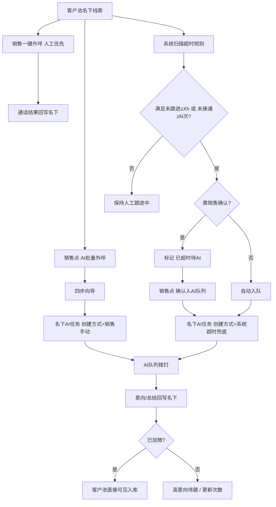
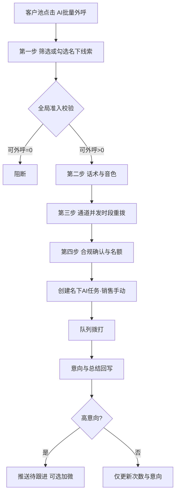
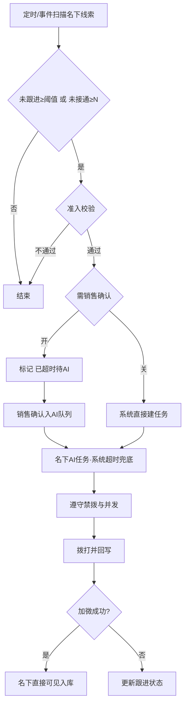
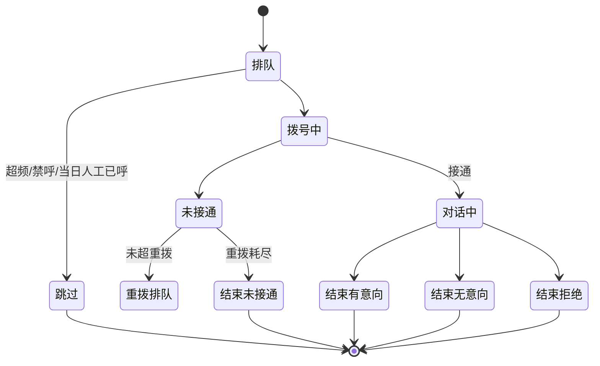

# 方案B · 深度绑定嵌合式 · 人工优先 · AI超时兜底 · 系统说明

> **浏览器请打开可渲染页：** [scheme-b-system.html](./scheme-b-system.html)（GitHub Pages 对 `.md` 会当纯文本，表格/流程图不会渲染）

> 产品：武汉电销系统 / 重洋启思电销系统（`/WH_CRM_v2/`）  
> 原型：`scheme-b/index.html`  
> 基线：`crm-refs/PRD-AI外呼机器人-CRM融合版.md`（2026-08）+ fusion-proto + **超时兜底增量**  
> 角色重心：**销售**清洗名下未接通/超时未跟库存；日常仍以人工一键外呼优先

## 1. 问题与目标

销售名下积压大量未跟进、多次未接通线索，人均日触达有限。方案B在**现有客户池**嵌入：

1. **人工优先**：保留并强调「一键外呼」；
2. **主动 AI**：销售可圈选发起「AI批量外呼」四步向导；
3. **超时兜底**：未跟进 ≥ X 小时或未接通 ≥ N 次时，系统标记/自动建**名下** AI 任务（可选需销售确认）。

结果回写意向与总结；**已加微则直接在名下可见入库**，不单独做承接池叙事。

## 2. CRM 挂载（改造 / 新增 / 复用）

| 模块 | 路径 | 动作 |
|------|------|------|
| 客户池 | `customer/ongoing` | **改造**：+AI批量外呼；+跟进状态（人工跟进中/已超时待AI/AI外呼中）；+确认入AI队列；原一键外呼/锁定/收藏/转移不变 |
| 个人信息 | 顶栏头像 | **改造**：+我的AI音色 |
| 外呼任务管理 | `aiOutbound/tasks` | **新增**（创建方式：销售手动 / 系统超时兜底） |
| AI外呼记录 | `aiOutbound/records` | **新增** |
| 全局配置 | `aiOutbound/globalConfig` | **新增**（含**超时兜底**页签） |
| 数据看板 | `aiOutbound/board` | **新增** |
| 通话记录 | `callRecord` | **复用写入** |
| 字典 | 意向/外呼状态/分层/付费 | **复用** |

## 3. 总览流程（人工优先 + 双入队）

## 4. 销售主动发起主流程

## 5. 超时兜底流程

## 6. 单通执行状态机

## 7. 超时兜底配置项（全局，销售弹窗不可绕过）

| 项 | 说明 | 默认示意 |
|----|------|----------|
| 启用超时兜底 | 总开关 | 开 |
| 未跟进超时时长 | 小时 | 24 |
| 未接通次数阈值 | 次 | 3 |
| 需销售确认后才外呼 | 开=只标记，确认后入队；关=自动建任务 | 开 |
| 禁拨时段 | 与合规页一致 | 22:00–08:00 |
| 兜底默认话术/通道 | 自动任务用 | 未接通回拨 / 火山 |
| 单次兜底任务上限 | 条 | 40 |

强制排除：已加微、锁定、免打扰、空号、A/B 禁止分层（可配置）、当日名额不足。

## 8. 四步向导摘要（PRD 7.2–7.5）

1. **筛选：**入库、外呼/接通/AI次数、外呼状态、意向度、分层、来源、学情报告、加微、付费分类等；试算「命中−剔除=可外呼」；全局剔除不可关闭。  
2. **话术音色：**已发布话术；个人复刻/公共/预置音色。  
3. **策略：**火山/阿里通道、并发、时段收窄、重拨、立即/预约。  
4. **确认：**效果成本预估、三项合规、名额顺延/拒绝。  

快捷预设：新入库未接通、沉默15天·D类、接通未加微、学情活跃未跟进、权益即将到期。

## 9. 全局配置边界（原有）

- A/B 类默认禁止 AI 直呼。  
- 免打扰/空号等强制项不可关。  
- 单销售每日名额 + 公司总量/并发；分组角色可覆盖。  
- 红线词命中降级并质检，连续命中下线话术版本。  

## 10. NON-GOAL

通话中转人工；自建线路；改人工外呼主流程；跨销售公共池调度（归方案A）；话术自动生成优化；单独「承接池」页面（已加微直接入库可见）。

## 11. 与额度 / 方案A

- 只操作本人名下（配置可开放组长跨组）。  
- 消耗「AI外呼名额」，与未拨打领取额度独立。  
- 加微成功后在名下直接可见；若走承接活码豁免，规则同企微承接额度 PRD。  
- 与方案A并列时：同一 `infoUuid` AI 状态互斥；通道并发共享。  

## 12. 指标

个人漏斗 + AI vs 人工同口径；任务维度区分手动/超时兜底；对齐 waihudata：通数、接通率、有效≥10s、意向、加微、未接通原因、总结导出。列表基础字段：**通话ID · 洋葱ID · 外呼手机号**。

## 13. 验收

向导三段数字实时变化；全局禁止项不可关；名额策略提示正确；任务可暂停继续终止重试；记录可转译与修正意向回写；音色授权复刻；配置保存后再次发起立即生效；超时规则开关/确认模式行为正确；任务列表可区分创建方式。
