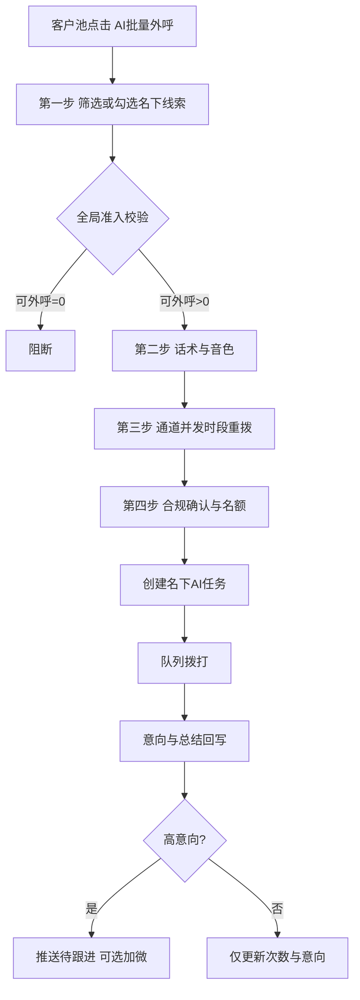
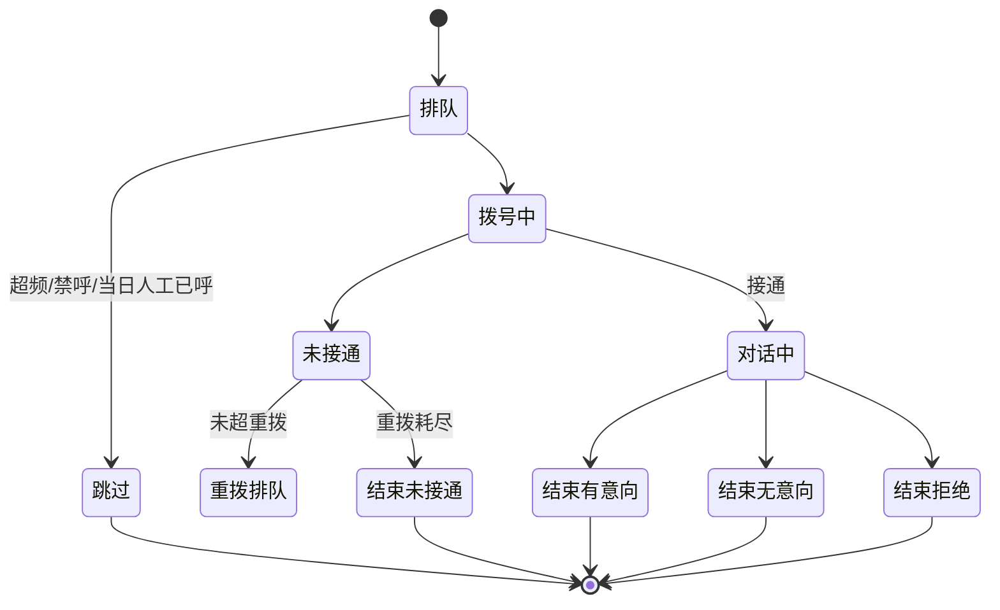

# 方案B · 深度绑定嵌合式 · 系统说明

> 产品：武汉电销系统 / 重洋启思电销系统（`/WH_CRM_v2/`）  
> 原型：`scheme-b/index.html`  
> 基线：`crm-refs/PRD-AI外呼机器人-CRM融合版.md`（2026-08）+ fusion-proto  
> 角色重心：**销售**清洗名下未接通/需 AI 外呼库存

## 1. 问题与目标

销售名下积压大量未跟进线索，人均日触达有限，时间耗在未接通与无意向上。方案B在**现有客户池**嵌入「AI批量外呼」四步向导，创建名下 AI 任务，由 AI 完成拨打、意向初筛与加微引导，高意向回写后由销售接续。

## 2. CRM 挂载（改造 / 新增 / 复用）

| 模块 | 路径 | 动作 |
|------|------|------|
| 客户池 | `customer/ongoing` | **改造**：+AI批量外呼；原一键外呼/锁定/收藏/转移不变 |
| 智能查询 | 现网话术模块 | **改造**：+AI外呼页签（缓存话术/节点/灰度） |
| 个人信息 | 顶栏头像 | **改造**：+我的AI音色（火山复刻） |
| 外呼任务管理 | `aiOutbound/tasks` | **新增** |
| AI外呼记录 | `aiOutbound/records` | **新增** |
| 全局配置 | `aiOutbound/globalConfig` | **新增**（销售弹窗不可绕过） |
| 数据看板 | `aiOutbound/board` | **新增** |
| 通话记录 | `callRecord` | **复用写入** |
| 字典 | 意向/外呼状态/分层/付费 | **复用** |

## 3. 销售发起主流程

## 4. 单通执行状态机

## 5. 四步向导摘要（PRD 7.2–7.5）

1. **筛选：**入库、外呼/接通/AI次数、外呼状态、意向度、分层、来源、学情报告、加微、付费分类等；试算「命中−剔除=可外呼」；全局剔除不可关闭。  
2. **话术音色：**已发布话术；个人复刻/公共/预置音色。  
3. **策略：**火山/阿里通道、并发、时段收窄、重拨、立即/预约。  
4. **确认：**效果成本预估、三项合规、名额顺延/拒绝。  

快捷预设：新入库未接通、沉默15天·D类、接通未加微、学情活跃未跟进、权益即将到期。

## 6. 全局配置边界

- A/B 类默认禁止 AI 直呼。  
- 免打扰/空号等强制项不可关。  
- 单销售每日名额 + 公司总量/并发；分组角色可覆盖。  
- 红线词命中降级并质检，连续命中下线话术版本。  

## 7. NON-GOAL

通话中转人工；自建线路；改人工外呼流程；跨销售公共池调度（归方案A）；话术自动生成优化。

## 8. 与额度 / 方案A

- 只操作本人名下（配置可开放组长跨组）。  
- 消耗「AI外呼名额」，与未拨打领取额度独立。  
- 加微若走承接活码，豁免规则同企微承接额度 PRD。  
- 与方案A并列时：同一 `infoUuid` AI 状态互斥；通道并发共享。  

## 9. 指标

个人漏斗 + AI vs 人工同口径；对齐 waihudata：通数、接通率、有效≥10s、意向、加微、未接通原因、总结导出。

## 10. 验收（摘自融合 PRD ACCEPT）

向导三段数字实时变化；全局禁止项不可关；名额策略提示正确；任务可暂停继续终止重试；记录可转译与修正意向回写；音色授权复刻；配置保存后再次发起立即生效。
