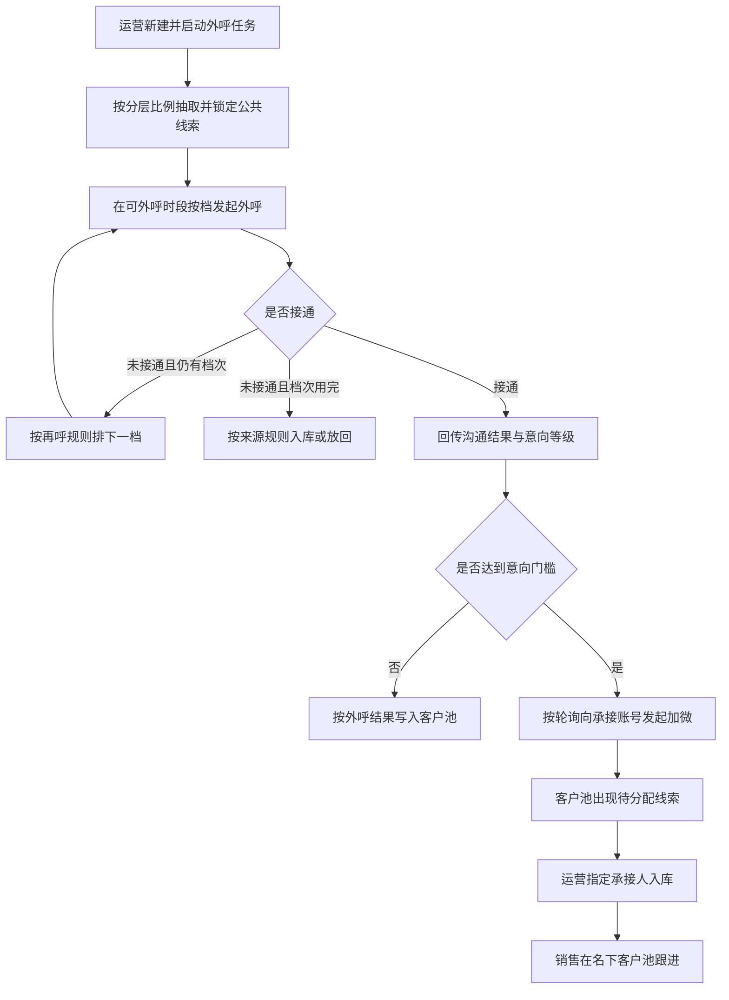
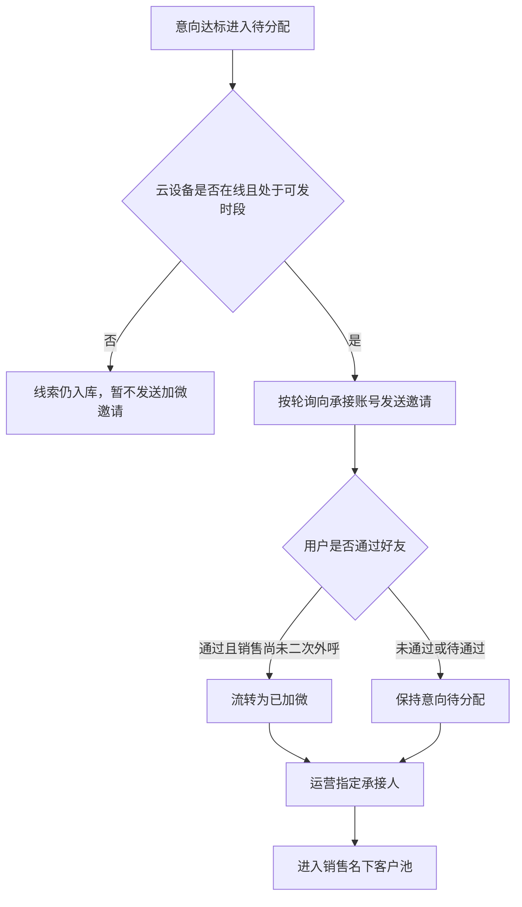

# PRD-AI外呼中心

## 一、修订记录

| 版本号 | 修改日期 | 修改原因 | 修订人 |
|--------|----------|----------|--------|
| v1.0 | 2026-11-12 | 按 prd-writer 技能模板重写二期需求（方案 A 独立拆分，客户池承接筛选与分配） | AI PRD Writer |
| v1.1 | 2026-11-12 | 补充一期依据链接、方案 A 边界，以及相对原方案 A 不建设的三项 | AI PRD Writer |
| v1.2 | 2026-11-12 | 按正式需求重做可交互原型，补全操作路径；内网发布链接待仓库部署脚本回填 | AI PRD Writer |

## 二、需求概述

**背景/现状：** 当测试接入已经能把人工智能外呼结果送回客户池时，运营仍无法按分层比例组建每日任务、配置企微承接并指定销售跟进，公共未领取线索只能继续靠销售手动申请。

**需求目标：** 当运营创建并启用人工智能外呼任务时，系统应按任务规则领取并外呼公共未领取线索；意向达标并完成加微流转后，运营应能在客户池筛选线索并指定承接人入库，且该条不占用销售的未拨打领取额度。

**核心逻辑简述：** 当运营在「AI任务」配好分层比例、时段和并发并启动后，系统应锁定抽取到的线索并按档外呼；出最终结果且达到意向门槛时，系统应按轮询向企微承接账号发起加微，并让运营在客户池完成指定承接人入库，销售随后用现有一键外呼和查看详情跟进。

**依据与边界：** 一期范围以飞书《PRD-AI外呼测试接入CRM》https://guanghe.feishu.cn/docx/HsAodUIEDoa4okxadY2ceWxwncd 为准。本期是方案 A「独立板块承接式 · AI 外呼中心」的正式落地，不引入另一套人工优先或超时兜底做法。相对原方案 A，本期不建设「通话明细」「外呼数据看板」「任务明细」，也不以同名或改名页签保留任务明细；客户筛选、意向流转和批量分配由客户池承接。

## 三、术语表

| 术语 | 定义 |
|------|------|
| 有效接通 | 电话接通，且这一次沟通时长不少于 10 秒 |
| 无效接通 | 电话接通，但这一次沟通时长不足 10 秒 |
| 未接通 | 电话没有接通。重复档次用完后仍未接通，才作为最终结果处理 |
| 意向等级 | 评分结果回传的甲乙丙丁四档，页面展示为 A、B、C、D。悬停可看说明：A 为直接跟进，已发送企微通知且用户已成功加上企业微信；B 为优先跟进，已发送企微通知且用户同意加微；C 为针对性跟进，未走到加微节点或明确不同意加微；D 为再次触达，开场后快速挂断 |
| 人工智能外呼状态 | 有效接通未加微、无效接通、有效接通已加微、未接通。非人工智能外呼线索显示横线 |
| 流转状态 | 客户池中用于分配进度的状态：人工智能处理中、意向待分配、已加微、已分配 |
| 人工智能处理中 | 线索已被任务抽取锁定，尚未按最终结果入库。只可查询，不可分配，销售不可领取 |
| 意向待分配 | 已出最终外呼结果且达到加微门槛，等待指定承接人 |
| 已加微 | 已加上承接所用企业微信好友，尚未完成指定销售入库 |
| 已分配 | 已指定承接人并进入该销售名下客户池，来源记为人工智能机器人 |
| 企微承接账号 | 专门用于意向线索发起加微邀请的企业微信账号，配置与销售侧企微机器人全局配置分开 |
| 轮询 | 本期加微分配的唯一方式：在云设备在线、承接已开启且未达当日上限的账号中依次分配 |
| 未拨打领取额度豁免 | 经人工智能加微并首次指定承接人入库的线索，不计入该销售的未拨打领取额度；转交或回收后再分配给其他销售时，恢复占用额度 |
| 政策禁呼时段 | 每日 21:00 至次日 09:00，系统均不可外呼 |

## 四、调整范围

- 侧栏新增「人工智能外呼中心」，本期建设「AI任务」「企微承接账号」两个业务页面；系统说明页仅用于对照规则，不作为业务操作台
- 在现有「客户池」上叠加：所属任务筛选、流转状态与对应视图、批量或单条指定承接人、客户详情中的任务与总结信息；「查看客户」从任务行进入客户池并带上该任务条件
- 沿用一期已有的人工智能外呼状态、意向等级、总结展示、申请客户拦截、一键外呼后不再自动改未加微状态，以及按档另建外呼任务、有效接通不少于 10 秒、加微以企业微信好友关系为准等规则
- 任务页顶部提供可折叠的实时观察，只汇总进行中任务、并发、已呼、接通、排队和意向待分配数量，不另建数据看板或通话名单页
- 相对原方案 A，本期不建设「通话明细」「外呼数据看板」「任务明细」三个独立模块；删除任务明细后，不另开任务客户页，相关筛选与分配均在客户池完成

## 五、业务流程图

**主流程：创建任务到指定承接人入库**

**加微与二次外呼**

## 六、可交互原型

可交互原型：发布中（内网 GitLab「SDD实践」待走仓库部署脚本取得 Pages 地址；洋葱 MinIO 已按 deploy-prototype 脚本上传，但 onion-fp-demo.yc345.tv / minio.yc345.tv 在本机 TCP 可通后 TLS 握手失败，未返回 public_url。禁止手写或编造 Pages 链接。）

原型模式：html-wireframe（单文件可交互原型，无需登录、无需本地启动）

涉及页面：客户池、人工智能外呼中心 / AI任务、人工智能外呼中心 / 企微承接账号、人工智能外呼中心 / 系统说明、新建或编辑任务弹窗、组织架构选人弹窗、任务详情抽屉、客户详情抽屉、指定承接人弹窗

可操作路径：
1. 顶部可切换角色，并可用「模拟工作时段 10:00 / 模拟政策禁呼 21:30」验证禁呼。页面顶部标明演示数据，不会发起真实外呼或企业微信通知。
2. 管理员或运营进入 AI任务：查看可收起的实时观察（进行中任务、已占用/可分配并发、今日已呼、接通率、排队、意向待分配），按名称、通道、状态查询或刷新（提示「已刷新任务列表」）。
3. 点击「新建AI外呼任务」：校验空名称、重名、未选通道、未选或已停用通话智能体、计划量范围、并发上限、结束时间、政策禁呼时段、禁拨时段重叠、再呼次数与间隔、分层合计须等于 100%；可重置为 5、15、5、5、70。通过后提示「已创建 AI 外呼任务」。
4. 对进行中任务点「暂停」，提示不再抽取新线索、已领出档次按剩余规则打完；对待开始或已暂停点「启动」，政策禁呼时段内不发起新拨打；线索不足的演示任务会提示按实际可抽数量执行。
5. 「详情」打开仅含概览、失败重试摘要、操作日志的抽屉，可「重试本档创建」；「查看客户」进入客户池并带上该任务，提示「已按任务筛选客户池」，不打开独立任务客户页。
6. 客户池可切全部客户、今日待跟进、意向待分配、已加微、已分配、人工智能处理中（后一视图仅管理员和运营）。查询完成、无结果、重置、另存为均有对应提示。
7. 勾选意向待分配或已加微后「批量分配」或行内「分配」，指定承接人、默认锁定 2 小时、写入待跟进提醒（仅演示提示）。混选不可分配线索会全部拦截。销售看不到分配按钮。
8. 「申请客户」可验证锁定拦截与测试坐席拦截；「一键外呼」对无手机号、人工智能处理中、有效接通未加微分别给出对应提示，且不真实拨号。
9. 企微承接账号含成员、加微通知策略、额度与豁免三个页签，无今日漏斗。添加成员时离线账号置灰不可选；离线开关不可开启；分配方式固定为轮询；策略必填项为空时保存拦截；关闭额度豁免须二次确认。
10. 销售或未授权人员进入 AI任务 / 企微承接账号时，提示「当前角色无权进入该配置页」并回到客户池。

关键态截图：`需求汇总/AI外呼中心/proto-shots/`，共 15 张

## 七、功能需求详细描述

### 7.1 AI任务列表与实时观察

入口在侧栏「人工智能外呼中心 / AI任务」，仅管理员和运营可进入。

**实时观察**位于列表上方，默认可收起、可展开。展示进行中任务数、当前已占用并发与可分配并发、今日已呼、接通率、排队等待条数、意向待分配条数，并列出进行中任务的名称、通道、并发占用、已呼与计划、接通率、意向和状态。本板块只做任务执行汇总，不展示漏斗对比或通话抽样名单。数据为演示或正式环境拉取结果；刷新间隔实现阶段确定，产品侧要求运营刷新后能看到最新汇总。

**任务列表字段**

| 字段名称 | 字段说明 | 字段来源 | 备注 |
|----------|----------|----------|------|
| 任务名称 | 任务展示名，下行展示任务编号 | 本次新增 | 名称为空不可保存 |
| 任务时间 | 任务起止时间 | 本次新增 | |
| 通道 | 火山或阿里 | 本次新增 | |
| 计划量 | 本任务计划外呼条数 | 本次新增 | |
| 已呼 | 已发起的外呼次数累计 | 外呼结果 | 没有则为 0 |
| 接通 | 已接通次数 | 外呼结果 | |
| 意向 | 本任务侧统计的意向条数 | 外呼结果 | 待分配处理以客户池为准 |
| 进度 | 已呼占计划量的比例 | 根据计划量与已呼计算 | 计划量为 0 时按 0 展示 |
| 状态 | 待开始、进行中、已暂停、已完成 | 本次新增 | |

列表可按名称、时间、通道、状态筛选，提供刷新。无任务时展示「暂无 AI 外呼任务」，并引导新建。

| 功能按钮 | 功能说明 | 是否必填 | 功能类型 | 交互说明 | 备注 |
|----------|----------|----------|----------|----------|------|
| 新建AI外呼任务 | 打开新建任务弹窗 | 否 | 按钮 | 校验通过后列表出现该任务，状态为待开始；若开始时间已到则可进入进行中 | 详见 7.2 |
| 查看客户 | 进入客户池并带上该任务筛选 | 否 | 行按钮 | 成功后提示「已按任务筛选客户池」，停留在客户池 | 不打开独立任务客户页 |
| 详情 | 打开任务详情抽屉 | 否 | 行按钮 | 只含概览、失败重试摘要、操作日志 | 详见 7.3 |
| 编辑 | 打开与新建相同的表单并回填已保存内容 | 否 | 行按钮 | 正在外呼的一档仍按原配置打完；计划量不可改得小于已呼量 | 校验失败不保存 |
| 启动 | 将待开始或已暂停的任务开始调度 | 否 | 行按钮 | 成功提示「任务已启动」；政策禁呼时段内不发起新的拨打 | 无在线可承接账号时建议警告，仍允许启动，加微阶段再跳过离线账号。该策略待确认 |
| 暂停 | 进行中的任务停止领取新的首次拨打 | 否 | 行按钮 | 提示「已暂停。不再抽取新线索。已领出未打完的档次按剩余规则打完」 | 人还在可分配范围时，不恢复销售手动领取已被锁定的线索 |
| 刷新 | 重新拉取任务列表与实时观察 | 否 | 按钮 | 成功提示「已刷新任务列表」 | |

### 7.2 新建 / 编辑 AI 外呼任务

以弹窗打开，分区为基本信息、并发配置、时间配置、线索分配比例。

| 字段名称 | 字段说明 | 是否必填 | 功能类型 | 交互说明 | 备注 |
|----------|----------|----------|----------|----------|------|
| 任务名称 | 文本 | 是 | 输入框 | 空则提示「请填写任务名称」；同一未结束周期内名称重复则提示「任务名称不能重复」 | |
| 通道 | 火山或阿里 | 是 | 下拉单选 | 未选不可提交 | 保存后还需选择该通道下可用的通话智能体；未选或已停用时不能启动或保存，提示「请选择可用的通话智能体」。本系统不创建、不编辑智能体 |
| 计划外呼量 | 正整数 | 是 | 数字输入框 | 允许 1 到 99999，不合法提示「计划外呼量需为 1 到 99999 的整数」 | 与分层比例分开填写 |
| 意向门槛 | 达到后发起加微并进入意向待分配 | 是 | 下拉单选 | 选项为「A 及以上」「B 及以上」「C 及以上」。默认建议「B 及以上」，待确认 | 只使用一期意向等级，不另建「重点意向」等正式名称 |
| 可分配并发 | 当前可分配路数与总路数 | 否 | 只读展示 | 展示当前可分配上限 | |
| 并发模式 | 独占 | 是 | 单选 | 本期仅提供独占：为任务预先占用并发，不被其他任务抢占 | |
| 任务并发 | 1 到可分配上限的整数 | 是 | 数字输入框 | 超出提示「任务并发请输入 1–上限 的整数」 | 等待创建的下一档不占用正在拨打的路数 |
| 任务时间 | 起止时间 | 是 | 时间选择 | 结束不晚于开始则提示「结束时间需晚于开始时间」 | 不能突破政策禁呼时段 |
| 禁拨时段 | 可多条，含名称与起止 | 否 | 时间选择 | 结束不晚于开始、与其他禁拨时段重叠时分别提示；可删除 | 与任务时间求交集后才可外呼 |
| 政策禁呼说明 | 每日 21:00 至次日 09:00 不可外呼 | 系统强制 | 提示文案 | 即使用户未配置，该窗口也不可外呼 | |
| 未接再呼 | 是否对未接通再建下一档 | 否 | 开关 | 默认开启。关闭则只打首次 | 只对未接通再建下一档，接通后不再创建 |
| 再呼次数 | 首次之外还可再建几档 | 开关打开时必填 | 数字输入框 | 允许 0 到 4 的整数，默认 2，不合法提示「再呼次数需为 0 到 4 的整数」 | 与一期按档另建任务一致 |
| 再呼间隔 | 下一档间隔分钟数 | 开关打开时必填 | 数字输入框 | 须为正整数，否则提示「再呼间隔需为正整数分钟」 | 若落到禁拨或政策禁呼时段，顺延到下一可呼时段 |
| 线索分配比例 | 公海分层 A、B、C、D、E 的占比 | 是 | 数字输入 | 均为 0 到 100 的整数，合计必须等于 100%，否则红字「合计须等于 100% 才能创建」，不可提交。占比为 0 的分层不抽取。提供重置，默认 5、15、5、5、70 | 计划量与比例分离 |
| 确定 | 提交创建或保存 | 否 | 按钮 | 校验失败停在弹窗并展示对应红字或提示，不保存。创建成功提示「已创建 AI 外呼任务」并回到列表；编辑成功提示「保存成功，立即生效」 | 高净值、已是在岗销售企微好友、黑名单、空号等现网不可呼线索强制不抽取。可用线索不足时允许创建，启动时提示「可用线索不足，将按实际可抽数量执行」 |

### 7.3 任务详情抽屉

从任务行「详情」打开。页签仅三个：概览、失败重试摘要、操作日志。不提供拨打名单工作台。

| 功能按钮 | 功能说明 | 是否必填 | 功能类型 | 交互说明 | 备注 |
|----------|----------|----------|----------|----------|------|
| 概览 | 展示计划、已呼、接通、意向、进度，以及任务时间、通道与并发、分层比例、状态、意向门槛 | 否 | 页签 | 只读 | |
| 失败重试摘要 | 展示因创建失败或结果未回而停留在本档的条数 | 否 | 页签 | 提供「重试本档创建」。失败不得按未接通处理 | 创建或回传失败时本档不入库、不跳到下一档 |
| 操作日志 | 展示创建、启动、暂停、编辑、系统开始调度等记录 | 否 | 页签 | 只读 | |
| 查看客户 | 关闭抽屉并进入客户池，带上该任务筛选 | 否 | 按钮 | 提示「已按任务筛选客户池」 | |
| 关闭 | 关闭抽屉 | 否 | 按钮 | 关闭后停留在任务列表，列表筛选保持不变 | 点击遮罩或关闭图标同样关闭 |

### 7.4 客户池

在现有客户池上叠加，不新增独立的任务客户页。管理员和运营可查看权限范围内的线索并进行分配；销售只看自己名下已分配线索，不能批量分配。「人工智能处理中」视图建议仅管理员和运营可见，是否对销售开放待确认。

**视图**

| 视图名称 | 规则 |
|----------|------|
| 全部客户 | 当前角色可见范围内的全部线索 |
| 今日待跟进 | 沿用一期：只保留已入库的有效接通未加微、无效接通、未接通 |
| 意向待分配 | 流转状态为意向待分配 |
| 已加微 | 流转状态为已加微且尚未完成分配 |
| 已分配 | 流转状态为已分配，可再按任务筛选 |
| 人工智能处理中 | 已被任务锁定、尚未最终入库；只读，无分配按钮；销售申请客户时仍拦截 |

待呼、正在外呼中的名单不在客户池展开，只在任务实时观察和任务详情概览中以数量展示。

**列表字段**（一期原列保留，下列为本次叠加或需一并展示的字段）

| 字段名称 | 字段说明 | 字段来源 | 备注 |
|----------|----------|----------|------|
| 家庭编号 | 沿用现网 | 客户池 | 原列保留 |
| 洋葱编号 | 沿用现网 | 客户池 | 原列保留 |
| 客户手机号 | 脱敏展示 | 客户池 | 原列保留 |
| 意向度 | 销售跟进意向 | 客户池 | 不由意向等级改写 |
| 外呼状态 | 沿用现网时长档 | 客户池 | |
| 人工智能外呼状态 | 有效接通未加微、无效接通、有效接通已加微、未接通 | 人工智能外呼 | 非该类线索显示横线 |
| 意向等级 | A、B、C、D，悬停显示跟进说明 | 评分回传 | 非该类线索显示横线；回传失败显示未分层 |
| 人工智能总结 | 列表最多一行，超出省略 | 评分回传 | 全文在客户详情；生成失败时显示「生成失败」 |
| 外呼次数 | 含人工智能与销售拨打 | 外呼记录 | 原列保留 |
| 最近一次拨打时间 | 最近一次拨打 | 外呼记录 | 没有则显示「暂无呼叫记录」 |
| 来源 | 沿用现网；分配入库后记为人工智能机器人 | 客户池 | 正式展示名与现网字典对齐，待确认 |
| 线索池 | 公海池或自助线索池 | 领取来源 | 非该类线索显示横线 |
| 坐席名称 | 当前归属坐席 | 客户池 | 分配后更新 |
| 是否成功加微 | 是否已是企业微信好友 | 企业微信好友关系 | 口头答应不算已加微 |
| 所属任务 | 任务名称与任务编号 | AI任务 | 非该类线索显示横线 |
| 流转状态 | 人工智能处理中、意向待分配、已加微、已分配 | 本次新增 | 无需流转时显示横线 |
| 承接账号 | 轮询到的加微账号 | 企微承接 | 未发起显示横线 |
| 分层 | 公海分层 A 至 E | 公共线索 | 便于核对抽取比例 |
| 操作 | 分配、一键外呼、查看详情 | 客户池 | 按角色和状态展示 |

**查询与操作**

| 功能按钮 | 功能说明 | 是否必填 | 功能类型 | 交互说明 | 备注 |
|----------|----------|----------|----------|----------|------|
| 家庭编号、洋葱编号、客户手机号 | 按对应信息查询 | 否 | 输入框 | 与其他条件同时生效 | 沿用现网 |
| 所属任务 | 按任务筛选 | 否 | 下拉 | 从任务行「查看客户」进入时自动选中该任务 | 本次新增 |
| 人工智能外呼状态 | 按四种结果查 | 否 | 下拉单选 | 仅管理员、运营和可见该类字段的销售使用 | 沿用一期 |
| 意向等级 | 按 A、B、C、D 查 | 否 | 下拉单选 | | 沿用一期 |
| 流转状态 | 按分配进度查 | 否 | 下拉或视图 | 与视图页签联动 | 本次新增 |
| 分层、承接账号 | 按分层或加微账号查 | 否 | 下拉 | | 本次新增 |
| 查询 | 按条件刷新列表 | 否 | 按钮 | 成功提示「查询完成」；无结果展示「暂无符合条件的数据」 | |
| 重置 | 清空本次筛选 | 否 | 按钮 | 恢复当前角色可见范围，视图回到全部客户 | 不改变当前登录角色 |
| 另存为 | 保存当前视图 | 否 | 按钮 | 提示「已另存为当前视图」 | 沿用现网 |
| 申请客户 | 从公海领取线索 | 否 | 按钮 | 线索已被人工智能锁定，或当前人仍适用一期测试坐席拦截时，分别提示「该线索正在由人工智能外呼处理，不能领取」「当前为 AI 外呼测试坐席，公海线索由 AI 领取，不能手动申请」。其他情况沿用现网申请成功提示 | 按钮保持可见，不隐藏。测试配置与正式任务如何并行待确认 |
| 一键外呼 | 沿用现网外呼 | 否 | 按钮 | 没有手机号提示「此线索没有手机号」。有手机号提示「已发起外呼」，外呼次数加 1，最近一次拨打时间更新。若该线索是有效接通未加微，额外提示「已发起外呼。之后即使加上企业微信，也不再自动改状态」 | 对人工智能处理中的线索，销售不可外呼，提示「该线索仍在人工智能处理中，不能外呼」 |
| 查看详情 | 打开客户详情 | 否 | 按钮，打开抽屉或侧栏 | 见 7.6。关闭后筛选保持不变 | |
| 分配 | 单条指定承接人 | 否 | 行按钮 | 仅意向待分配或已加微可点；其他状态点击提示「当前流转状态不可分配」。销售无此按钮 | |
| 批量分配 | 对勾选线索指定同一承接人 | 否 | 按钮 | 未勾选时按钮置灰。勾选中若含不可分配线索，全部拦截并提示「请只勾选意向待分配或已加微的线索」，列出原因 | 仅管理员和运营 |

### 7.5 指定承接人弹窗

| 功能按钮 | 功能说明 | 是否必填 | 功能类型 | 交互说明 | 备注 |
|----------|----------|----------|----------|----------|------|
| 已选线索 | 展示将要分配的条数 | 否 | 只读 | 批量时注明批量 | |
| 指定承接人 / 销售 | 选择入库后的跟进人 | 是 | 下拉单选 | 未选不可确认 | 选项为可承接的账号或销售 |
| 入库后锁定 | 分配后是否短期锁定 | 否 | 下拉 | 默认「锁定 2 小时」；也可不锁定，或锁定至首次跟进 | 沿用现网锁定能力 |
| 写入待跟进提醒 | 是否给承接人发站内提醒 | 否 | 勾选 | 默认勾选 | 不在本系统外发真实消息的演示环境可只做提示 |
| 确认分配 | 提交分配 | 否 | 按钮 | 成功后流转状态改为已分配，坐席名称更新，来源记为人工智能机器人，总结同步到详情，提示「已分配给某某，总结已同步」。弹窗关闭，勾选清空，列表停留在客户池并保留筛选 | 同一条线索重复提交时，第二次提示已分配，不改写已成功的承接人；若需改人，走现网转交 |
| 取消 | 关闭弹窗 | 否 | 按钮 | 不改变列表 | |

### 7.6 客户详情

| 功能按钮 | 功能说明 | 是否必填 | 功能类型 | 交互说明 | 备注 |
|----------|----------|----------|----------|----------|------|
| 查看详情 | 展示家庭编号、洋葱编号、手机号、学段、分层、坐席、意向度、外呼状态、人工智能外呼状态、意向等级、是否成功加微、来源、线索池、所属任务、流转状态、承接账号、入库说明、总结全文 | 否 | 抽屉或侧栏 | 非人工智能入库线索，总结位置写「这条线索不是人工智能外呼入库，没有人工智能总结。」关闭、点击遮罩均关闭详情，客户池筛选保持不变 | 详情内也可一键外呼或去分配，规则与列表相同；去分配仅在合法状态且当前人为管理员或运营时显示 |

### 7.7 企微承接账号

独立于销售侧企微机器人全局配置。三个页签：承接账号、加微通知策略、额度与豁免。不设今日漏斗页签。

**成员列表字段**

| 字段名称 | 字段说明 | 字段来源 | 备注 |
|----------|----------|----------|------|
| 成员 | 头像与姓名 | 组织通讯录 | 展示对齐现有渠道活码成员 |
| 账号标识 | 企业微信账号标识 | 组织通讯录 | 用业务可识别的账号名展示，不写技术字段名 |
| 组织架构 | 所在部门路径 | 组织通讯录 | 可用组织快速筛选 |
| 云设备 | 在线或离线 | 云设备回传 | 离线默认不承接 |
| 今日承接与上限 | 当日已承接数与上限 | 本次新增 | 达到上限后不再进入轮询，直到次日或上限调高 |
| 账号状态 | 启用、额度将满、停用 | 本次新增 | |
| 承接开关 | 承接中或不承接 | 本次新增 | 离线强制不承接且开关不可开启 |

| 功能按钮 | 功能说明 | 是否必填 | 功能类型 | 交互说明 | 备注 |
|----------|----------|----------|----------|----------|------|
| 添加成员 | 打开组织架构选人弹窗 | 是，确定时至少一名在线成员 | 按钮 | 可搜索姓名或账号，可筛在线或离线。仅云设备在线可勾选；离线置灰，点击提示「云设备离线，不可添加为承接成员」。确定时若含离线则拦截。已在列表中的成员不重复添加，提示「所选成员已在列表中」或报告新加人数 | 与一期测试坐席「离线可以加入」不同：本期离线默认不承接，也不能作为可开启承接的新成员添加。已在列表后变为离线的成员保留，但开关禁用 |
| 刷新设备状态 | 重新获取云设备在线状态 | 否 | 按钮 | 成功提示「已刷新云设备与活码状态」 | |
| 组织快速筛选 | 按小组过滤列表 | 否 | 筛选标签 | 与表头组织筛选联动 | 全部 / 各小组 |
| 承接开关 | 开启或关闭该账号承接 | 否 | 开关 | 在线可开可关；离线点击提示「云设备离线，默认不承接，无法开启」 | 关闭后不再被轮询到 |
| 编辑 | 修改日上限等 | 否 | 行按钮 | 加微文案在策略页签维护 | |
| 移除 | 将成员移出承接名单 | 否 | 行按钮 | 确认后提示「已移除」。已发出未完成的加微不回滚历史 | |
| 保存 | 保存本页配置 | 否 | 按钮 | 成功提示「承接配置已保存」 | 策略页必填项未填时拦截，见 7.8 |

### 7.8 加微通知策略

| 字段名称 | 字段说明 | 是否必填 | 功能类型 | 交互说明 | 备注 |
|----------|----------|----------|----------|----------|------|
| 分配方式 | 固定为轮询 | 是 | 只读 | 展示「轮询」，并注明本期仅此方式 | 不提供按额度加权或指定账号 |
| 活码渠道标记 | 用于识别进线渠道 | 否 | 输入框 | | |
| 加微昵称 | 客户侧看到的名称 | 是 | 输入框 | 空则保存时提示填写 | |
| 意向门槛 | 与任务默认门槛对齐 | 否 | 下拉 | 任务级门槛优先于本页默认 | 选项同任务：A 及以上、B 及以上、C 及以上 |
| 企业微信邀请通知模版 | 发出邀请时的文案 | 是 | 多行输入 | 空则保存时提示填写 | |
| 加微通过欢迎语 | 好友通过后的欢迎文案 | 是 | 多行输入 | 空则保存时提示填写 | |
| 失败重试 | 发送失败后的处理 | 否 | 下拉 | 可选：失败后换账号重试 1 次、重试 2 次、记入待人工 | |
| 静默时段不发加微 | 该时段不发送邀请 | 否 | 时间或文本 | 例如 22:00 至 08:00；静默期内等到时段结束后再发 | |

### 7.9 额度与豁免

展示今日人工智能承接入库条数、豁免未拨打额度条数、销售名下因此占用的条数。提供开关「启用企微承接不占未拨打领取额度」，默认开启；关闭须二次确认。提供「分配入库时自动将来源记为人工智能机器人」，默认开启。可配置单账号日承接上限默认值。测试或演示数据须标明为演示。

### 7.10 入库、加微与异常

| 场景 | 规则 |
|------|------|
| 领取范围 | 任务只领取销售尚未领取、且按现网规则本来可被领取的公共线索；公海与自助新增分别受任务计划和来源规则约束 |
| 锁定期间 | 销售领取该线索时提示正在由人工智能外呼处理，不能再领。同一条线索不能进入两个进行中的任务 |
| 公海线索档次用完仍未接通 | 按未接通入库；流转状态不是意向待分配 |
| 自助新增档次用完仍未接通 | 不入库，释放后按现网自助规则处理 |
| 有效接通未加微 | 接通且不少于 10 秒，判定时还不是好友。公海和自助新增接通后都入库 |
| 无效接通 | 接通但不足 10 秒。之后即使加上好友，仍保持无效接通。接通后不再创建下一档 |
| 有效接通已加微 | 有效接通，且销售二次外呼前已加上承接所用企业微信。口头答应不算已加微 |
| 评分未回传成功 | 外呼状态仍按接通和加微规则入库；总结显示生成失败，意向等级显示未分层 |
| 未达意向门槛 | 不进入意向待分配。非意向但已入库线索的默认归属待确认：可回写结果但不强制进入批量待分配箱 |
| 加微静默或云设备离线 | 不发送邀请，线索仍按外呼结果入库，可在条件恢复后按失败重试策略补发 |
| 任务暂停或结束 | 不再新抽取；已领出未打完的档次按剩余规则打完 |
| 并发已满 | 不发起新的本档外呼，线索继续等待，不记为未接通 |
| 创建或结果未回 | 本档不入库、不跳到下一档，不按未接通处理，可在失败重试摘要中再次创建本档 |
| 测试数据 | 端到端联调用例与账号待提供；原型中的名单均为演示数据 |

意向门槛与一期等级对应：选「A 及以上」时仅 A 进入加微与意向待分配；选「B 及以上」时 A、B 进入；选「C 及以上」时 A、B、C 进入。D 及未分层不因本门槛进入意向待分配。

### 7.11 角色进入与跳转

管理员和运营打开系统后可进入人工智能外呼中心配置页和客户池全量视图。销售打开后不能进入 AI任务、企微承接账号；若直接访问，提示「当前角色无权进入该配置页」并回到客户池。分配、查看客户、关闭详情后，均回到来源列表并保留筛选与分页。

## 八、埋点与数据需求

本需求不新增埋点。

## 九、权限说明

| 角色 | 可见与可操作 |
|------|----------------|
| 管理员 / 运营管理员 | 可进入 AI任务、企微承接账号。可创建、编辑、启动、暂停任务，维护承接成员与加微策略。客户池可见人工智能相关字段、所属任务、流转状态，可筛选、查看详情、批量或单条指定承接人。不能在本系统改评分提示词和分层名称 |
| 销售 | 不能进入 AI任务和企微承接账号。客户池只看自己名下已分配线索，可见人工智能外呼状态、意向等级和总结；非该类线索相应位置显示横线。不能申请已被锁定的线索，不能批量分配。可一键外呼、查看详情 |
| 其他未授权人员 | 不能进入人工智能外呼中心配置。自己的客户池是否展示人工智能三列，沿用一期「其他坐席不展示」的规则；若组织决定二期全员可见，须另确认 |
