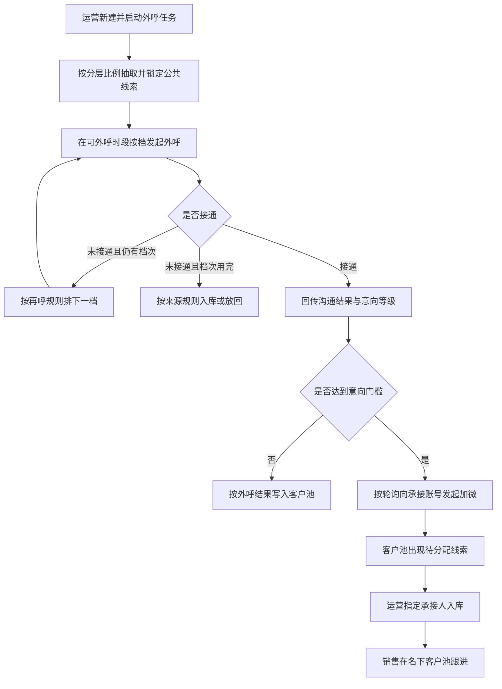
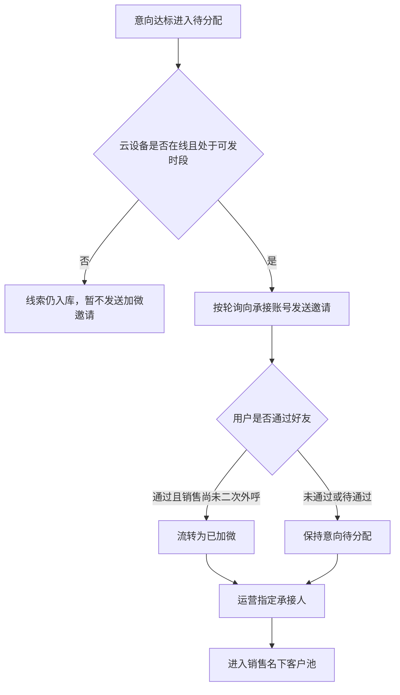

# PRD-V2-AI外呼中心

## 一、修订记录

- v1.0｜2026-11-12｜按 prd-writer 技能新版模板重写二期需求｜AI PRD Writer
- v1.1｜2026-11-12｜补充一期依据链接、方案 A 边界，以及相对原方案 A 不建设的三项｜AI PRD Writer
- v1.2｜2026-11-12｜按正式需求重做可交互原型，补全操作路径；内网发布链接待仓库部署脚本回填｜AI PRD Writer

## 二、需求概述

**背景**：运营还不能按每日任务吞吐公共未领取线索并指定销售跟进。

**目标**：运营可创建任务完成外呼，并在客户池把意向线索指定给销售入库。

**核心逻辑**：运营在 AI 任务中配好比例、时段和并发并启动后，系统锁定抽取到的公共线索并按档外呼；达到意向门槛则按轮询发起加微，运营再在客户池指定承接人入库，且不占用该销售的未拨打领取额度。

**依据与边界**：一期范围以飞书《PRD-AI外呼测试接入CRM》https://guanghe.feishu.cn/docx/HsAodUIEDoa4okxadY2ceWxwncd 为准。本期是方案 A「独立板块承接式 · AI 外呼中心」的正式落地，不引入另一套人工优先或超时兜底做法。相对原方案 A，本期不建设「通话明细」「外呼数据看板」「任务明细」，也不以同名或改名页签保留任务明细；客户筛选、意向流转和批量分配由客户池承接。

## 三、术语表

- **有效接通**：电话接通，且这一次沟通时长不少于 10 秒。
- **无效接通**：电话接通，但这一次沟通时长不足 10 秒。
- **未接通**：电话没有接通；重复档次用完后仍未接通，才作为最终结果处理。
- **意向等级**：评分回传的 A、B、C、D。A 为直接跟进，已发送企微通知且用户已成功加上企业微信；B 为优先跟进，已发送企微通知且用户同意加微；C 为针对性跟进，未走到加微节点或明确不同意加微；D 为再次触达，开场后快速挂断。
- **人工智能外呼状态**：有效接通未加微、无效接通、有效接通已加微、未接通。
- **流转状态**：人工智能处理中、意向待分配、已加微、已分配。
- **人工智能处理中**：线索已被任务抽取锁定、尚未按最终结果入库，只可查询，不可分配，销售不可领取。
- **企微承接账号**：专门用于意向线索发起加微邀请的企业微信账号，与销售侧企微机器人全局配置分开。
- **轮询**：本期加微分配的唯一方式，在云设备在线、承接已开启且未达当日上限的账号中依次分配。
- **未拨打领取额度豁免**：经人工智能加微并首次指定承接人入库的线索，不计入该销售未拨打领取额度；转交或回收后再分配给其他销售时，恢复占用。
- **政策禁呼时段**：每日 21:00 至次日 09:00，系统均不可外呼。

## 四、调整范围

### 4.1 涉及的一级页面

- 客户池：在现有页面叠加任务筛选、流转视图与指定承接人
- AI任务：新建、管理每日外呼任务并查看执行汇总
- 企微承接账号：维护加微所用企业微信账号与通知策略

### 4.2 涉及的二级页面

- 任务详情抽屉：从 AI 任务打开，查看概览、失败重试摘要和操作日志
- 客户详情：从客户池打开，查看总结全文与任务、流转信息

### 4.3 涉及的弹窗

- 新建或编辑 AI 外呼任务（从 AI 任务打开）
- 组织架构选人（从企微承接账号添加成员时打开）
- 指定承接人（从客户池单条或批量分配时打开）

本期不建设「通话明细」「外呼数据看板」「任务明细」，也不另开任务客户页。系统说明如需对照规则，不作为业务操作台。

## 五、业务流程图

**主流程：创建任务到指定承接人入库**

**加微与二次外呼**

## 六、可交互原型

可交互原型：发布中（内网 GitLab「SDD实践」待走仓库部署脚本取得 Pages 地址；洋葱 MinIO 已按 deploy-prototype 脚本上传，但 onion-fp-demo.yc345.tv / minio.yc345.tv 在本机 TCP 可通后 TLS 握手失败，未返回 public_url。禁止手写或编造 Pages 链接。）

原型模式：html-wireframe（单文件可交互原型，无需登录、无需本地启动）

涉及页面：客户池、人工智能外呼中心 / AI任务、人工智能外呼中心 / 企微承接账号、人工智能外呼中心 / 系统说明、新建或编辑任务弹窗、组织架构选人弹窗、任务详情抽屉、客户详情抽屉、指定承接人弹窗

可操作路径：
1. 顶部可切换角色，并可用「模拟工作时段 10:00 / 模拟政策禁呼 21:30」验证禁呼。页面顶部标明演示数据，不会发起真实外呼或企业微信通知。
2. 管理员或运营进入 AI任务：查看可收起的实时观察（进行中任务、已占用/可分配并发、今日已呼、接通率、排队、意向待分配），按名称、通道、状态查询或刷新（提示「已刷新任务列表」）。
3. 点击「新建AI外呼任务」：校验空名称、重名、未选通道、未选或已停用通话智能体、计划量范围、并发上限、结束时间、政策禁呼时段、禁拨时段重叠、再呼次数与间隔、分层合计须等于 100%；可重置为 5、15、5、5、70。通过后提示「已创建 AI 外呼任务」。
4. 对进行中任务点「暂停」，提示不再抽取新线索、已领出档次按剩余规则打完；对待开始或已暂停点「启动」，政策禁呼时段内不发起新拨打；线索不足的演示任务会提示按实际可抽数量执行。
5. 「详情」打开仅含概览、失败重试摘要、操作日志的抽屉，可「重试本档创建」；「查看客户」进入客户池并带上该任务，提示「已按任务筛选客户池」，不打开独立任务客户页。
6. 客户池可切全部客户、今日待跟进、意向待分配、已加微、已分配、人工智能处理中（后一视图仅管理员和运营）。查询完成、无结果、重置、另存为均有对应提示。
7. 勾选意向待分配或已加微后「批量分配」或行内「分配」，指定承接人、默认锁定 2 小时、写入待跟进提醒（仅演示提示）。混选不可分配线索会全部拦截。销售看不到分配按钮。
8. 「申请客户」可验证锁定拦截与测试坐席拦截；「一键外呼」对无手机号、人工智能处理中、有效接通未加微分别给出对应提示，且不真实拨号。
9. 企微承接账号含成员、加微通知策略、额度与豁免三个页签，无今日漏斗。添加成员时离线账号置灰不可选；离线开关不可开启；分配方式固定为轮询；策略必填项为空时保存拦截；关闭额度豁免须二次确认。
10. 销售或未授权人员进入 AI任务 / 企微承接账号时，提示「当前角色无权进入该配置页」并回到客户池。

关键态截图：`需求汇总/AI外呼中心/proto-shots/`，共 15 张

## 七、功能需求详细描述

### 7.1 AI任务列表与实时观察

**所在位置**：人工智能外呼中心 → AI任务页顶部与主列表

**功能目标**：让运营查看每日任务进度，并完成新建、启停、查看客户和打开详情。

**功能类型**：列表、汇总卡片、行按钮

**默认状态**：进入页面后实时观察默认展开，任务按创建或进行中情况列出；无任务时展示「暂无 AI 外呼任务」，并引导新建。

**详细规则**：
1. 实时观察展示进行中任务数、当前已占用并发与可分配并发、今日已呼、接通率、排队等待条数、意向待分配条数，以及进行中任务的名称、通道、并发占用、已呼与计划、接通率、意向和状态。
2. 本板块只做任务执行汇总，不展示漏斗对比或通话抽样名单。点击标题可收起或展开。
3. 列表从左到右展示：任务名称与任务编号、任务时间、通道、计划量、已呼、接通、意向、进度、状态。状态为待开始、进行中、已暂停、已完成。没有已呼时显示 0。
4. 可按名称、时间、通道、状态筛选；点刷新后提示「已刷新任务列表」。
5. 「查看客户」进入客户池并带上该任务筛选，提示「已按任务筛选客户池」，不打开独立任务客户页。
6. 「详情」打开任务详情抽屉。「编辑」打开与新建相同的表单并回填；正在外呼的一档仍按原配置打完；计划量不可改得小于已呼量。
7. 「启动」在待开始或已暂停时可用，成功提示「任务已启动」；政策禁呼时段内不发起新的拨打。无在线可承接账号时建议警告仍允许启动，该策略待确认。
8. 「暂停」仅进行中可点，提示「已暂停。不再抽取新线索。已领出未打完的档次按剩余规则打完」。
9. 销售进入本页时，系统应提示「当前角色无权进入该配置页」并回到客户池。

### 7.2 新建或编辑 AI 外呼任务

**所在位置**：AI任务页 → 新建或编辑弹窗

**功能目标**：让运营配好一次每日任务的基本信息、并发、时间和分层比例。

**功能类型**：表单弹窗

**表单项**（从上到下）：
1. **任务名称**（输入框）：是否必填 = 是。空则提示「请填写任务名称」。同一未结束周期内名称重复则提示「任务名称不能重复」。
2. **通道**（下拉单选）：是否必填 = 是。选项为火山、阿里。保存后还需选择该通道下可用的通话智能体；未选或已停用时不能启动或保存，提示「请选择可用的通话智能体」。本系统不创建、不编辑智能体。
3. **计划外呼量**（数字输入）：是否必填 = 是。须为 1 到 99999 的整数，否则提示「计划外呼量需为 1 到 99999 的整数」。与分层比例分开填写。
4. **意向门槛**（下拉单选）：是否必填 = 是。选项为「A 及以上」「B 及以上」「C 及以上」。默认建议「B 及以上」，待确认。只使用一期意向等级。
5. **可分配并发**（只读）：展示当前可分配路数与总路数。
6. **并发模式**（单选）：是否必填 = 是。本期仅提供独占，为任务预先占用并发。
7. **任务并发**（数字输入）：是否必填 = 是。须为 1 到可分配上限的整数，否则提示「任务并发请输入 1–上限 的整数」。等待创建的下一档不占用正在拨打的路数。
8. **任务时间**（起止时间）：是否必填 = 是。结束不晚于开始则提示「结束时间需晚于开始时间」。不能突破每日 21:00 至次日 09:00 的政策禁呼时段。
9. **禁拨时段**（可多条时间）：是否必填 = 否。结束不晚于开始或互相重叠时分别提示，可删除。
10. **未接再呼**（开关）：默认开启。关闭则只打首次。只对未接通再建下一档，接通后不再创建。
11. **再呼次数**（数字输入）：开关打开时必填 = 是。允许 0 到 4 的整数，默认 2，否则提示「再呼次数需为 0 到 4 的整数」。
12. **再呼间隔**（数字输入，单位分钟）：开关打开时必填 = 是。须为正整数，否则提示「再呼间隔需为正整数分钟」。若落到禁拨或政策禁呼时段，顺延到下一可呼时段。
13. **线索分配比例**（五个数字，对应公海分层 A 至 E）：是否必填 = 是。均为 0 到 100 的整数，合计必须等于 100%，否则红字「合计须等于 100% 才能创建」，不可提交。占比为 0 的分层不抽取。提供重置，默认 5、15、5、5、70。

**提交行为**：
1. 确定按钮在校验未通过时保持可点但提交失败，停在弹窗并展示对应红字或提示，不保存。
2. 创建成功提示「已创建 AI 外呼任务」并回到列表，新任务为待开始，或在开始时间已到时进入进行中。编辑成功提示「保存成功，立即生效」。
3. 高净值、已是在岗销售企微好友、黑名单、空号等现网不可呼线索强制不抽取。可用线索不足时允许创建，启动时提示「可用线索不足，将按实际可抽数量执行」。

**取消行为**：点击取消或关闭图标关闭弹窗，不保存。

### 7.3 任务详情抽屉

**所在位置**：AI任务列表点击「详情」打开

**功能目标**：只读查看任务执行概况、失败停留条数和操作记录，并跳转到客户池。

**触发方式**：任务行「详情」

**布局结构**：
1. **顶部**：任务编号与名称，关闭图标。
2. **中部页签**：概览展示计划、已呼、接通、意向、进度，以及任务时间、通道与并发、分层比例、状态、意向门槛，均为只读。失败重试摘要展示因创建失败或结果未回而停留在本档的条数，并提供「重试本档创建」；失败不得按未接通处理，本档不入库、不跳到下一档。操作日志展示创建、启动、暂停、编辑、系统开始调度等记录。
3. **底部**：关闭、查看客户。

**关闭行为**：关闭、点击遮罩后停留在任务列表，列表筛选保持不变。「查看客户」关闭抽屉并进入客户池，带上该任务筛选，提示「已按任务筛选客户池」。本抽屉不提供拨打名单工作台。

### 7.4 客户池列表

**所在位置**：客户管理 → 客户池

**功能目标**：在现有客户池上完成查询、查看意向流转，并由运营指定承接人。

**列表字段**（按展示顺序，一期原列保留，并叠加本次字段）：
1. **家庭编号、洋葱编号、客户手机号**：沿用现网。手机号脱敏。来源：客户档案。
2. **意向度**：展示销售跟进意向。不由意向等级改写。
3. **外呼状态**：沿用现网时长档。
4. **人工智能外呼状态**：展示有效接通未加微、无效接通、有效接通已加微、未接通。非该类线索显示横线。
5. **意向等级**：展示 A、B、C、D，悬停显示跟进说明。回传失败显示未分层。非该类线索显示横线。
6. **人工智能总结**：列表最多一行，超出省略；全文在详情。生成失败时显示「生成失败」。
7. **外呼次数、最近一次拨打时间**：沿用外呼记录。没有拨打时间时显示「暂无呼叫记录」。
8. **来源**：分配入库后记为人工智能机器人。正式展示名与现网字典对齐，待确认。
9. **线索池**：公海池或自助线索池。非该类线索显示横线。
10. **坐席名称**：当前归属坐席，分配后更新。
11. **是否成功加微**：以企业微信好友关系为准，口头答应不算已加微。
12. **所属任务**：任务名称与任务编号。非该类线索显示横线。来源：AI 任务。
13. **流转状态**：人工智能处理中、意向待分配、已加微、已分配；无需流转时显示横线。
14. **承接账号**：轮询到的加微账号；未发起显示横线。
15. **分层**：公海分层 A 至 E。
16. **操作**：按角色和状态展示分配、一键外呼、查看详情。

**列表操作**：
1. 视图包括：全部客户；今日待跟进（沿用一期，只保留已入库的有效接通未加微、无效接通、未接通）；意向待分配；已加微且尚未完成分配；已分配；人工智能处理中（只读，无分配按钮）。待呼和正在外呼中的名单不在本页展开，只在任务实时观察中以数量展示。
2. 筛选项：家庭编号、洋葱编号、客户手机号、所属任务、人工智能外呼状态、意向等级、流转状态、分层、承接账号。多条件同时生效。从任务行进入时自动选中该任务。
3. 查询成功提示「查询完成」。无结果展示「暂无符合条件的数据」。重置后恢复当前角色可见范围，视图回到全部客户。另存为沿用现网，提示「已另存为当前视图」。
4. 申请客户按钮保持可见。当线索已被锁定，系统应提示「该线索正在由人工智能外呼处理，不能领取」。当当前人仍适用一期测试坐席拦截时，提示「当前为 AI 外呼测试坐席，公海线索由 AI 领取，不能手动申请」。其他情况沿用现网申请成功提示。测试配置与正式任务如何并行，待确认。
5. 一键外呼沿用现网：没有手机号提示「此线索没有手机号」；有手机号提示「已发起外呼」，次数加 1 并更新最近拨打时间；若为有效接通未加微，额外提示「已发起外呼。之后即使加上企业微信，也不再自动改状态」。对人工智能处理中的线索，提示「该线索仍在人工智能处理中，不能外呼」。
6. 「人工智能处理中」视图建议仅管理员和运营可见，是否对销售开放待确认。

**异常与兜底**：
1. 列表为空或无筛选结果：展示「暂无符合条件的数据」。
2. 不可分配状态点击分配：提示「当前流转状态不可分配」。

### 7.5 指定承接人

**所在位置**：客户池操作栏或行内「分配」

**功能目标**：把意向待分配或已加微的线索指定给销售入库。

**功能类型**：按钮与弹窗

**启用条件**：
1. 当前用户为管理员或运营。销售无此按钮。
2. 单条分配仅当流转状态为意向待分配或已加微。
3. 批量分配须已勾选至少一条；未勾选时按钮置灰。勾选中若含不可分配线索，全部拦截并提示「请只勾选意向待分配或已加微的线索」，列出原因。

**点击后流程**：
1. 打开指定承接人弹窗，只读展示已选条数；批量时注明批量。
2. 指定承接人 / 销售为必填下拉，未选不可确认。
3. 入库后锁定默认为「锁定 2 小时」，也可不锁定或锁定至首次跟进。写入待跟进提醒默认勾选。
4. 确认成功后，流转状态改为已分配，坐席名称更新，来源记为人工智能机器人，总结同步到详情，提示「已分配给某某，总结已同步」。弹窗关闭，勾选清空，列表停留在客户池并保留筛选。
5. 同一条线索重复提交时，第二次提示已分配，不改写已成功的承接人；若需改人，走现网转交。
6. 取消则关闭弹窗，不改变列表。

### 7.6 客户详情

**所在位置**：客户池点击「查看详情」打开

**功能目标**：查看该线索的外呼结果、总结全文和流转信息，并在合法时去分配或一键外呼。

**布局结构**：
1. **中部**：家庭编号、洋葱编号、手机号、学段、分层、坐席、意向度、外呼状态、人工智能外呼状态、意向等级、是否成功加微、来源、线索池、所属任务、流转状态、承接账号、入库说明、总结全文。
2. **非人工智能入库线索**：总结位置写「这条线索不是人工智能外呼入库，没有人工智能总结。」
3. **底部**：关闭；合法状态且当前人为管理员或运营时显示「去分配」；详情内也可一键外呼，规则与列表相同。

**关闭行为**：关闭或点击遮罩后回到客户池，筛选保持不变。

### 7.7 企微承接账号成员

**所在位置**：人工智能外呼中心 → 企微承接账号 → 承接账号页签

**功能目标**：用组织架构选出可发加微的企业微信账号，并控制是否承接。

**列表字段**：
1. **成员**：头像与姓名，展示对齐现有渠道活码成员。来源：组织通讯录。
2. **账号标识**：企业微信账号的业务识别名。
3. **组织架构**：所在部门路径，可用组织快速筛选。
4. **云设备**：在线或离线。离线默认不承接。
5. **今日承接与上限**：达到上限后不再进入轮询，直到次日或上限调高。
6. **账号状态**：启用、额度将满、停用。
7. **承接开关**：承接中或不承接。

**详细规则**：
1. 「添加成员」打开组织架构选人弹窗，可搜索姓名或账号，可筛在线或离线。仅云设备在线可勾选；离线置灰，点击提示「云设备离线，不可添加为承接成员」。确定时至少一名在线成员，若含离线则拦截。已在列表中的不重复添加，并提示新加人数或「所选成员已在列表中」。
2. 本期与一期测试坐席不同：离线不能作为可开启承接的新成员添加。已在列表后变为离线的成员保留，但开关禁用。
3. 在线可开可关承接；离线点击开关提示「云设备离线，默认不承接，无法开启」。关闭后不再被轮询到。
4. 「刷新设备状态」成功提示「已刷新云设备与活码状态」。组织快速筛选与表头组织筛选联动。
5. 「移除」确认后提示「已移除」。已发出未完成的加微不回滚历史。
6. 「保存」成功提示「承接配置已保存」；策略页必填项未填时拦截。本页不设今日漏斗页签，配置与销售侧企微机器人全局配置分开。

### 7.8 加微通知策略与额度豁免

**所在位置**：企微承接账号 → 加微通知策略、额度与豁免页签

**功能目标**：约定加微如何轮询发送，以及入库后是否占用未拨打领取额度。

**表单项**：
1. **分配方式**（只读）：固定展示「轮询」，并注明本期仅此方式。不提供按额度加权或指定账号。
2. **活码渠道标记**（输入框）：是否必填 = 否。用于识别进线渠道。
3. **加微昵称**（输入框）：是否必填 = 是。空则保存时提示填写。
4. **意向门槛**（下拉）：选项同任务。任务级门槛优先于本页默认。
5. **企业微信邀请通知模版、加微通过欢迎语**（多行输入）：是否必填 = 是。空则保存时提示填写。
6. **失败重试**（下拉）：失败后换账号重试 1 次、重试 2 次、或记入待人工。
7. **静默时段不发加微**：例如 22:00 至 08:00；静默期内等到时段结束后再发。

**额度与豁免**：
1. 展示今日人工智能承接入库条数、豁免未拨打额度条数、销售名下因此占用的条数。演示数据须标明为演示。
2. 「启用企微承接不占未拨打领取额度」默认开启，关闭须二次确认。
3. 「分配入库时自动将来源记为人工智能机器人」默认开启。可配置单账号日承接上限默认值。

### 7.9 横切规则

**身份校验**：
1. 用户进入 AI任务或企微承接账号前，系统校验其为管理员或运营；未通过时提示「当前角色无权进入该配置页」并回到客户池。

**状态机**：
1. 公共未领取线索被任务抽取后进入「人工智能处理中」，销售不可领取。
2. 出最终结果后按一期规则写入人工智能外呼状态。达到意向门槛的进入「意向待分配」；加微通过且销售尚未二次外呼的进入「已加微」；指定承接人后进入「已分配」。
3. 意向门槛与一期等级对应：选「A 及以上」时仅 A 进入加微与意向待分配；选「B 及以上」时 A、B 进入；选「C 及以上」时 A、B、C 进入。D 及未分层不因本门槛进入意向待分配。
4. 公海线索档次用完仍未接通，按未接通入库，流转状态不是意向待分配。自助新增档次用完仍未接通，不入库。有效接通不少于 10 秒；无效接通之后即使加微仍保持无效接通。口头答应不算已加微。销售对有效接通未加微一点击一键外呼，之后即使加微也不再自动改状态。
5. 评分未回传成功时，外呼状态仍按接通和加微规则入库，总结显示生成失败，意向等级显示未分层。非意向但已入库线索的默认归属待确认。
6. 加微静默或云设备离线时不发送邀请，线索仍按外呼结果入库，条件恢复后可按失败重试补发。任务暂停或结束后不再新抽取，已领出未打完的档次按剩余规则打完。并发已满时不发起新的本档外呼，不记为未接通。创建或结果未回时本档不入库、不跳档、不按未接通处理。同一条线索不能进入两个进行中的任务。

**跳转闭环**：
1. 从任务「查看客户」或详情「查看客户」进入客户池，并带上该任务。关闭详情或分配弹窗后回到客户池，保留筛选与分页。
2. 关闭任务详情后回到任务列表，保留列表筛选。

**权限分支**：
1. 管理员和运营可配置任务与承接账号，可在客户池全量筛选并指定承接人。不能在本系统改评分提示词和分层名称。
2. 销售只看自己名下已分配线索，可见人工智能外呼状态、意向等级和总结；不能批量分配，不能申请已被锁定的线索，可一键外呼和查看详情。
3. 其他未授权人员不能进入配置页。自己的客户池是否展示人工智能三列，沿用一期其他坐席不展示的规则；若组织决定二期全员可见，须另确认。

**测试数据**：端到端联调用例与账号待提供；原型中的名单均为演示数据。

## 八、埋点与数据需求

本需求不新增埋点。

## 九、权限说明

1. **管理员 / 运营管理员**：可进入 AI任务、企微承接账号。可创建、编辑、启动、暂停任务，维护承接成员与加微策略。客户池可见人工智能相关字段、所属任务、流转状态，可筛选、查看详情、批量或单条指定承接人。不能在本系统改评分提示词和分层名称。
2. **销售**：不能进入 AI任务和企微承接账号。客户池只看自己名下已分配线索，可见人工智能外呼状态、意向等级和总结；非该类线索相应位置显示横线。不能申请已被锁定的线索，不能批量分配。可一键外呼、查看详情。
3. **其他未授权人员**：不能进入人工智能外呼中心配置。自己的客户池是否展示人工智能三列，沿用一期其他坐席不展示的规则；若组织决定二期全员可见，须另确认。
